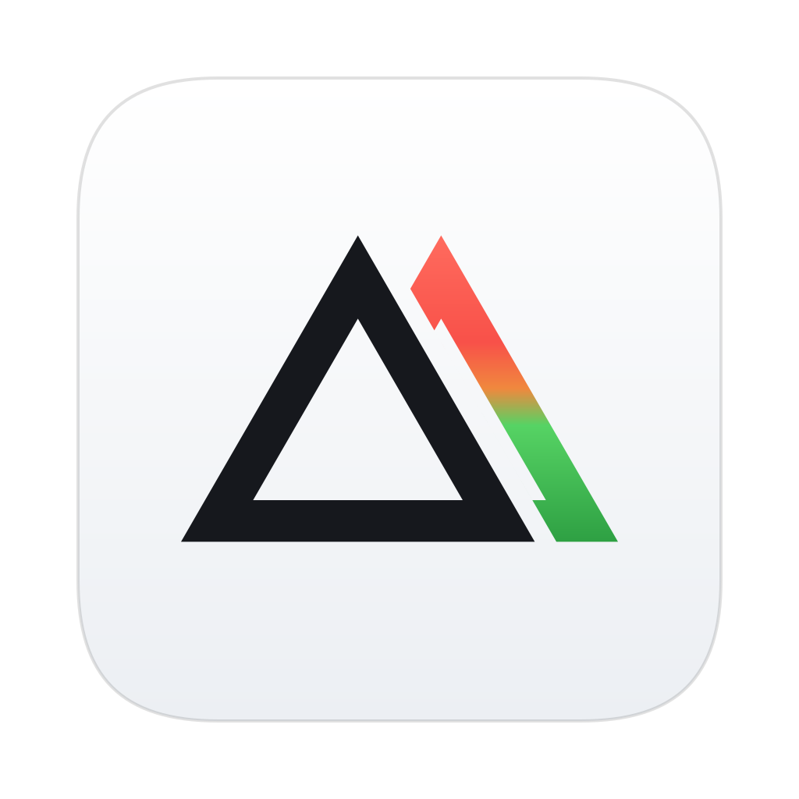
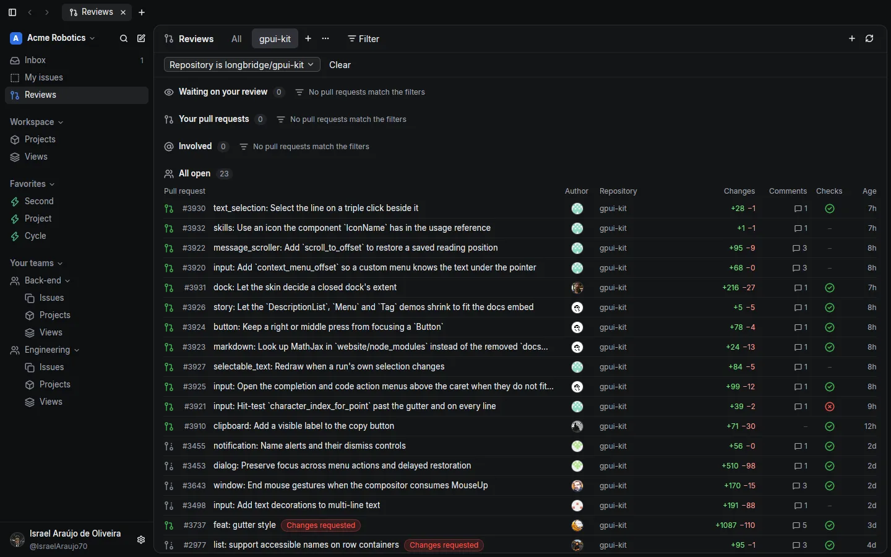
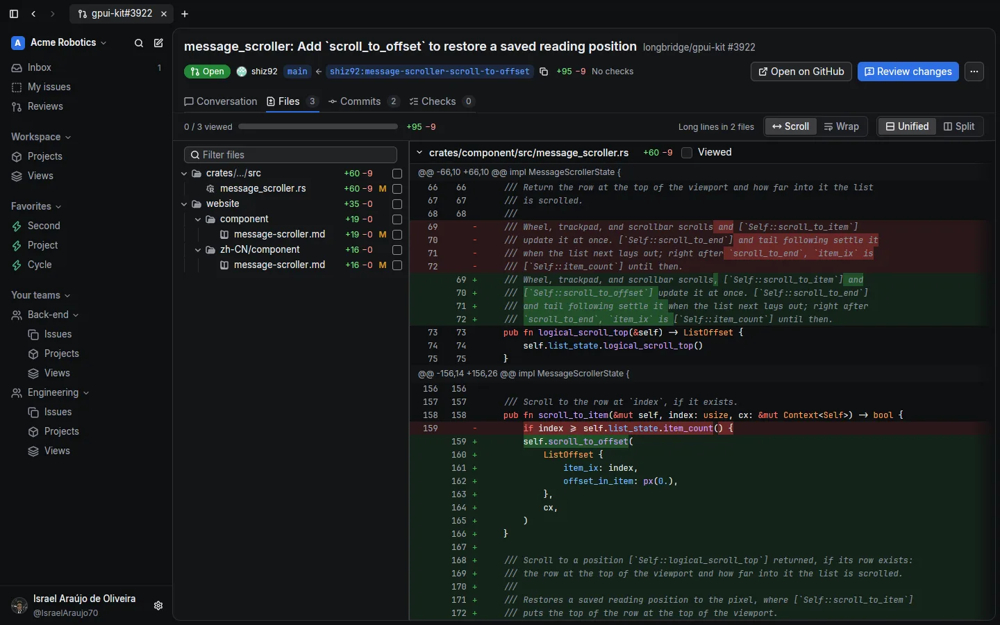
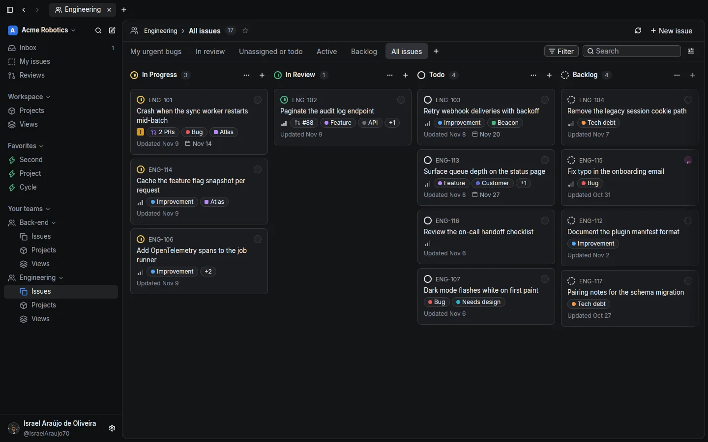
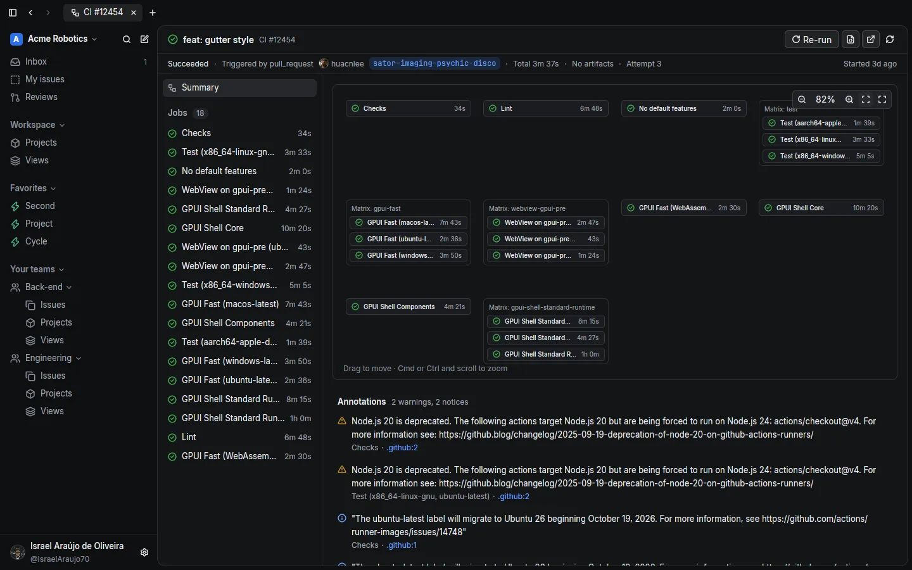
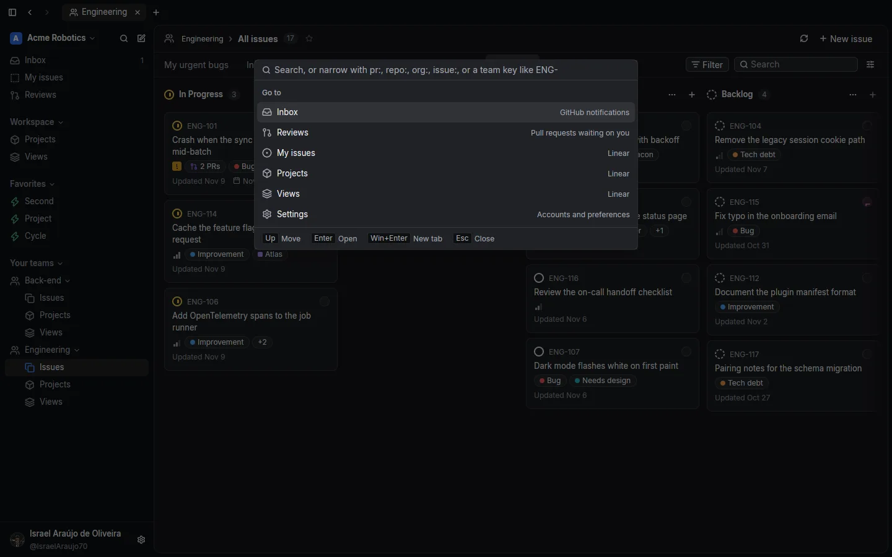

# Loupe

GitHub reviews and Linear issues, in one fast desktop app.

Loupe is a native app for macOS and Linux, built in Rust with [GPUI](https://www.gpui.rs). It puts the pull requests waiting on you, the Linear issues they close, and the CI runs behind them in one window, with tabs, a command palette, and the keyboard first. It talks to GitHub and Linear directly from your machine: there is no Loupe account and no Loupe server.

Website: [loupe.israeldeveloper.com.br](https://loupe.israeldeveloper.com.br)



## What it does

- **Reviews.** The pull requests waiting on your review, the ones you opened, and the ones you are involved in, filtered by organization, repository, people, or status. Save a filter as a view; a view that names repositories also lists every other open pull request in them.
- **Inbox.** Your GitHub notifications, filtered and marked as read in bulk.
- **Pull requests.** Conversation, review threads, files with a syntax-highlighted diff, and checks, in a tab. Comment, reply, approve, or request changes without leaving the app.
- **Actions.** Workflow runs with the graph of their jobs, the log of a failed step, and re-runs.
- **Linear.** Your issues, team boards, projects, and saved views, with several workspaces. Move an issue, change its assignee or labels, and see the pull requests linked to it.
- **Command palette.** Cmd+K opens any pull request, repository, issue, or command.
- **Themes.** Six built-in themes, each with a light and a dark palette, switched live.
- **Review with T3 Code.** Hand a pull request to a [T3 Code](https://github.com/pingdotgg/t3code) server, which starts a review thread in a worktree of its head.

| Pull request files | Linear board |
|---|---|
|  |  |
| **Actions** | **Command palette** |
|  |  |

## Download

Get the latest build from [Releases](https://github.com/IsraelAraujo70/loupe/releases/latest):

- macOS (Apple silicon): `loupe-macos-aarch64.zip`. Unzip it and move `Loupe.app` to Applications. The app is signed but not notarized, so the first time, right-click it and choose **Open**.
- Linux (x86_64): `loupe-linux-x86_64`. Make it executable (`chmod +x loupe-linux-x86_64`) and run it. It needs X11 or Wayland and a Vulkan driver.

Once installed, Loupe checks for a new release every hour and offers to update and restart.

## Build from source

Loupe uses Rust 1.99.1, pinned in `rust-toolchain.toml`; `rustup` installs it on the first build.

```sh
git clone https://github.com/IsraelAraujo70/loupe.git
cd loupe
cargo run --release
```

- **macOS:** Xcode with the Metal toolchain (`xcodebuild -downloadComponent MetalToolchain`). `scripts/bundle-macos.sh --install` builds `dist/Loupe.app` and copies it to `~/Applications`.
- **Linux:** the libraries GPUI links against. On Debian or Ubuntu:

  ```sh
  sudo apt-get install pkg-config cmake build-essential libxcb1-dev libxkbcommon-dev \
    libxkbcommon-x11-dev libwayland-dev libfontconfig-dev libfreetype-dev libvulkan-dev \
    libssl-dev libzstd-dev libasound2-dev
  ```

Run the checks the CI runs:

```sh
cargo fmt --all --check
cargo clippy --workspace --all-targets -- -D warnings
cargo test --workspace
```

`LOUPE_DATA_DIR=<dir>` keeps settings and tokens in that directory, so a development run never touches your real data. In debug builds, `LOUPE_LINEAR_ENDPOINT` points Loupe at another Linear GraphQL endpoint, such as the local stub with sample data:

```sh
cargo run -p loupe-linear --example stub_server   # http://127.0.0.1:8787/graphql
LOUPE_LINEAR_ENDPOINT=http://127.0.0.1:8787/graphql LINEAR_API_KEY=stub cargo run
```

The website lives in `site/`: `python3 site/build.py` writes it to `site/public`, and its `Dockerfile` serves it with Caddy.

See [docs/ARCHITECTURE.md](docs/ARCHITECTURE.md) for the crates and their contracts, and [docs/RELEASES.md](docs/RELEASES.md) for how releases and updates work.

## Configuration

Tokens stay on your machine: in the macOS Keychain (service `dev.loupe.app`), or in files under `~/.config/loupe` on Linux. Loupe sends each one only to the API it belongs to.

**GitHub.** Loupe tries a stored token first, then `GITHUB_TOKEN`, then `gh auth token`. If none works, the sign-in screen offers the OAuth device flow (scopes `repo read:org notifications`) or a pasted personal access token.

**Linear.** Create a personal API key at [linear.app/settings/account/security](https://linear.app/settings/account/security) and add it in Settings > Accounts, or set `LINEAR_API_KEY`. Add one key per workspace; Settings maps GitHub organizations or repositories to the workspace their issues live in.

**T3 Code.** In Settings, enter the server URL (for example `https://t3.example.com:3774`) and a token from that server.

## Keyboard shortcuts

On Linux, Cmd is the Super key.

| Shortcut | Action |
|---|---|
| Cmd+K | Command palette (Cmd+Enter opens the result in a new tab) |
| Cmd+T | New tab |
| Cmd+W | Close the tab |
| Cmd+1 … Cmd+8, Cmd+9 | The tab at that position, the last tab |
| Ctrl+Tab, Ctrl+Shift+Tab | The next tab, the previous tab |
| Cmd+[ , Cmd+] | Back, forward in the tab |
| Cmd+click, right-click > Open in new tab | Open a pull request or issue in a new tab |
| Cmd+B | Toggle the sidebar |
| Cmd+, | Settings |
| F | Filter Reviews or a Linear board |
| J, K | Move through a list |
| Page Down / Page Up | Scroll the current screen by a page |
| Cmd+Shift+W | Close the window |
| Cmd+Q | Quit |

## Links

Inside Loupe, a link to a GitHub pull request or to an issue of your Linear workspace opens in a Loupe tab: in comments, descriptions, review threads, and an issue's links. Cmd+click opens it in a new tab. Right-click a link for Open in new tab, Open in browser, and Copy link. Any other link opens in the browser.

Loupe also opens these URLs from other apps, in the tab that already shows the page or in a new one:

- `loupe://pr/<owner>/<repo>/<number>` and `loupe://issue/<identifier>`, for scripts, Raycast, and Alfred: `open loupe://pr/acme/web/42`;
- `https://github.com/<owner>/<repo>/pull/<number>` and `https://linear.app/<workspace>/issue/<identifier>` of the signed-in workspace, when another app sends them to Loupe. Loupe ignores any other URL it is sent, rather than pass it to the default browser, which could send it straight back.

macOS sends every `https` link to the default browser. To send pull request and Linear issue links to Loupe, use [Finicky](https://github.com/johnste/finicky) as the default browser, with this `~/.finicky.js`:

```js
// ~/.finicky.js
export default {
  defaultBrowser: "Google Chrome",
  handlers: [
    {
      // Pull requests and your Linear workspace's issues open in Loupe;
      // everything else in Chrome. Replace acme with your workspace's slug.
      match: ["github.com/*/pull/*", "linear.app/acme/issue/*"],
      browser: "Loupe",
    },
  ],
};
```

## License

Loupe is free software under the [GNU Affero General Public License v3.0](LICENSE) (`AGPL-3.0-only`). The bundled fonts (Inter, JetBrains Mono) are under the SIL Open Font License, and the file icons come from [Zed](https://github.com/zed-industries/zed); see the `PROVENANCE.md` files under `crates/loupe-app/assets/`.
